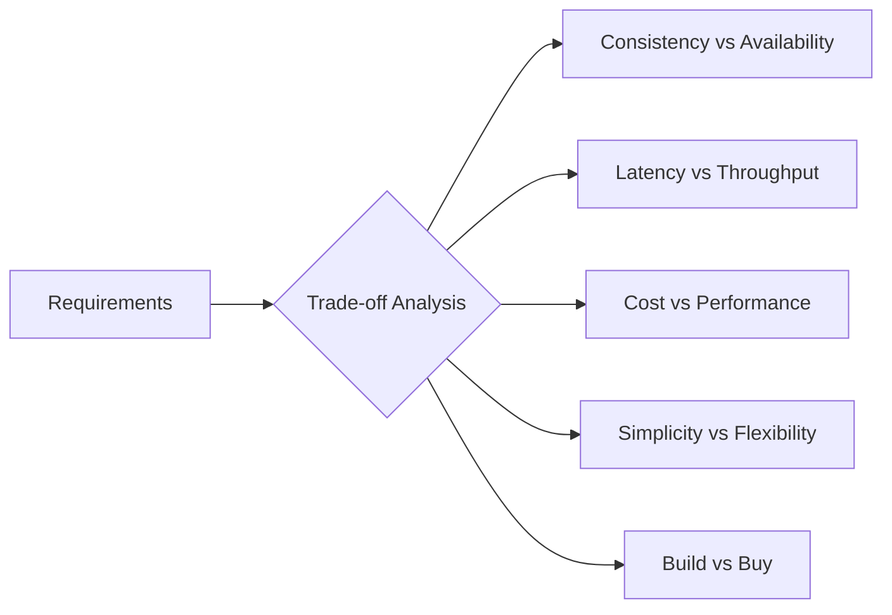

# Chapter 0: Introduction — What Is System Design?

> **Prerequisite**: None. This is the starting point for everyone.

---

## What Is System Design?

**System Design** is the process of defining the architecture, components, interfaces, and data flows for a system that satisfies specified requirements. It sits between:

- **Requirements** (what the system must do)
- **Implementation** (code, infrastructure, deployment)

```
Requirements  ──►  System Design  ──►  Implementation
(Functional,                (Architecture,              (Code, CI/CD,
 Non-functional)             Components,                Tests, Deploy,
                             Data models,               Monitoring)
                             Trade-offs)
```

### HLD vs LLD

| Level | Scope | Audience | Artifacts |
|-------|-------|----------|-----------|
| **HLD (High-Level Design)** | System-wide: services, databases, message queues, external APIs | Architects, Tech Leads, Interviewers | Architecture diagrams, API contracts, data flow, capacity estimates |
| **LLD (Low-Level Design)** | Single service: classes, schemas, algorithms, sequences | Developers | Class diagrams, DB schemas, pseudocode, sequence diagrams |

> **In interviews**: You're tested on HLD. LLD may come up in deep dives.

---

## Why System Design Matters

### The Scale Problem

```
┌─────────────────────────────────────────────────────────────────────┐
│  A single server works until...                                    │
│                                                                     │
│  • Users grow from 100 → 100M                                      │
│  • Data grows from 1 GB → 100 TB                                   │
│  • Requests grow from 10 QPS → 1M QPS                              │
│  • Team grows from 2 → 200 engineers                               │
│  • Downtime cost grows from $0 → $1M/min                           │
│                                                                     │
│  The code that worked at 100 users *will not work* at 100M.       │
│  System design is the discipline of making it work anyway.         │
└─────────────────────────────────────────────────────────────────────┘
```

### Real-World Impact

| Company | Scale Challenge | Design Decision That Mattered |
|---------|----------------|-------------------------------|
| **WhatsApp** | 2B users, 100B msgs/day | FreeBSD + Erlang, epoll, minimal servers |
| **Discord** | Millions concurrent voice | Elixir/OTP, WebSocket, guild-based sharding |
| **Uber** | Real-time matching at scale | Geohash + ringpop + custom dispatch |
| **Netflix** | Global video delivery | Open Connect CDN, chaos engineering |
| **Stripe** | Payments reliability | Idempotency keys, event sourcing, careful DB choice |

---

## The System Design Mindset

### 1. **Everything Is a Trade-Off**
There is no "best" — only "best for *these* constraints."



### 2. **Design for Failure**
> "Everything fails, all the time." — Werner Vogels, AWS CTO

- Networks partition
- Disks corrupt
- Processes crash
- Clocks drift
- Humans make mistakes

**Your design must specify what happens when (not if) each fails.**

### 3. **Estimate Before You Architect**
Back-of-envelope math tells you *which* problems are hard:

```
QPS = DAU × actions_per_user / 86400 × peak_multiplier
Storage = users × data_per_user × replication_factor
Bandwidth = QPS × avg_response_size
```

If peak QPS is 100K, a single database write path **will not work** — you need sharding *before* you draw the diagram.

### 4. **Start Simple, Add Complexity Only When Needed**
```
MVP (1 server) → Read Replicas → Cache → Sharding → Multi-region
     │              │            │         │            │
     ▼              ▼            ▼         ▼            ▼
   Works       Read scale    Hot data  Write scale  Disaster recovery
   at scale    without       without   without      without data loss
               DB pressure   DB hits   single DB    across regions
```

---

## The Universal Design Framework

Every system design — whether a 45-minute interview or a 3-month architecture project — follows the same structure:

```
┌─────────────────────────────────────────────────────────────────────┐
│  1. CLARIFY REQUIREMENTS                                            │
│     • Functional: What does it do? (CRUD, real-time, search...)    │
│     • Non-functional: Scale, latency, availability, consistency    │
│     • Constraints: Budget, team, timeline, compliance              │
├─────────────────────────────────────────────────────────────────────┤
│  2. ESTIMATE SCALE (Back-of-envelope)                              │
│     • QPS (read/write), storage, bandwidth, memory                 │
│     • Identify the *binding constraint* (CPU? disk? network? RAM?) │
├─────────────────────────────────────────────────────────────────────┤
│  3. HIGH-LEVEL ARCHITECTURE (HLD)                                  │
│     • Components & data flow (client → LB → services → DB)         │
│     • API contracts (REST/gRPC), data models                       │
│     • Justify each component choice                                 │
├─────────────────────────────────────────────────────────────────────┤
│  4. DEEP DIVES (2-3 critical components)                           │
│     • Database: schema, partitioning, replication                  │
│     • Cache: strategy, eviction, invalidation                      │
│     • Queue: topology, delivery semantics, ordering                │
│     • Algorithms: ranking, matching, indexing                      │
├─────────────────────────────────────────────────────────────────────┤
│  5. TRADE-OFFS & FAILURE MODES                                     │
│     • What breaks first? (SPOF, hot shard, thundering herd)        │
│     • How do you detect & recover?                                 │
│     • Cost at scale?                                               │
├─────────────────────────────────────────────────────────────────────┤
│  6. OPERATIONAL CONCERNS                                           │
│     • Deployments (blue-green, canary)                             │
│     • Observability (metrics, logs, traces)                        │
│     • Security (auth, encryption, rate limiting)                   │
└─────────────────────────────────────────────────────────────────────┘
```

---

## Symbols & Notation Used in This Repo

| Symbol | Meaning |
|--------|---------|
| ✅ | **Exercise** — Do this before moving on |
| 🔁 | **Review prompt** — Spaced repetition |
| ⚠️ | **Pitfall** — Common mistake / anti-pattern |
| 💡 | **Insight** — Rule of thumb / senior perspective |
| 📐 | **Estimation drill** — Work it out on paper |
| 🔗 | **Cross-reference** — See another chapter |
| `Mermaid` | Architecture / flow diagram |
| `ASCII` | Inline diagram (works everywhere) |

---

## How to Read This Repo

### If You're New to System Design
```
Read sequentially: 00 → 01 → 02 → 03 → 04 → 05 → 06 → 07 → 08 → 09 → 10 → 11 → 12 → 13
Do every ✅ exercise. Come back to 🔁 prompts in 1 day, 3 days, 7 days.
```

### If You're Interviewing in 4 Weeks
```
Week 1: 00, 01, 02, 03, 13 (estimation cheatsheet)
Week 2: 04, 05, 06
Week 3: 07, 08, 09, 10
Week 4: 12 (6 case studies), mock interviews
```

### If You're an AI Engineer
```
Priority: 11 (complete) → 03 (vector DBs) → 05 (semantic caching) → 06 (async pipelines) → 07 (GPU reliability)
```

### If You're a Senior/Staff Engineer
```
Skim 00-03 for notation. Deep dive: 04, 06, 07, 09, 11. Use 13 as reference.
```

---

## Quick Reference: Numbers Every Engineer Should Know

### Latency Hierarchy (Orders of Magnitude)

| Operation | Latency | Notes |
|-----------|---------|-------|
| L1 cache reference | 0.5 ns | CPU-local |
| L2 cache reference | 7 ns | |
| Main memory read | 100 ns | DDR4/5 |
| Mutex lock/unlock | 25 ns | Uncontended |
| SSD random read | 16 µs | NVMe |
| Datacenter RTT | 0.5 ms | Same AZ |
| Redis/Memcached RTT | 0.5–1 ms | Local network |
| SSD sequential 1 MB | 1 ms | |
| Cross-region RTT | 50–150 ms | US coast-to-coast |
| Database query (indexed) | 1–10 ms | Local DB |
| Complex DB join | 10–100+ ms | Why indexes matter |

> **Rule of thumb**: One cross-region RTT (~100 ms) dominates a datacenter cache hit (sub-ms). If your design needs 20 sequential RPCs across regions, latency exceeds 1 second before application logic runs — **batch, parallelize, or move data closer**.

### Throughput Anchors

| System | Typical QPS | Notes |
|--------|-------------|-------|
| Single PostgreSQL (writes) | ~1–5K | Leader bottleneck |
| Single PostgreSQL (reads) | ~10–50K | With read replicas |
| Redis (single node) | ~100K–500K | In-memory, simple ops |
| Kafka (single partition) | ~50K–100K | Sequential writes |
| Load balancer (L7) | ~100K–1M | Depends on CPU |
| CDN edge | ~1M+ | Static content |

---

## ✅ Exercises

1. **Estimate**: Calculate QPS, storage, and bandwidth for a Twitter-like service with 300M DAU, 500 tweets/user/day, 1KB/tweet, 100:1 read:write ratio.
2. **Identify**: For the above, what's the binding constraint at peak? (CPU? disk? network? memory?)
3. **Trade-off**: You're building a chat app. List 3 trade-offs between WebSockets and Server-Sent Events (SSE).
4. **Failure mode**: Your single-postgres-primary design loses the primary. What happens to in-flight writes? Reads?

---

## 🔁 Review Prompts

- What's the difference between HLD and LLD? When do you use each?
- Name 3 non-functional requirements you must clarify before designing.
- Why is "design for failure" a mindset, not a checklist?
- What does "binding constraint" mean in capacity estimation?

---

## 📚 Further Reading

- [What Is System Design? — Grokking](https://grokkingthesystemdesign.com/complete-guide-to-system-design)
- [System Design Primer — Donne Martin](https://github.com/donnemartin/system-design-primer)
- *Designing Data-Intensive Applications*, Ch 1 — Martin Kleppmann
- [The Tail at Scale](https://research.google/pubs/pub40801/) — Dean & Barroso (Google)
